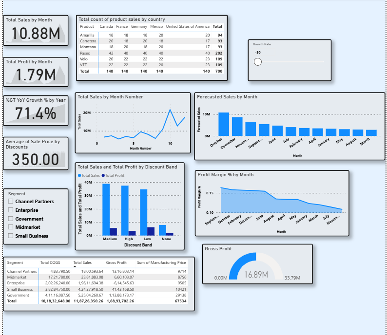

# Financial-Forecasting-Profitability-Dashboard

##  Project Overview
This project is a high-impact, single-page professional Power BI financial forecasting and profitability dashboard built using a robust star schema data model. 
It integrates historical financial performance, interactive What-If scenario simulations, and deep-dive discount optimization metrics into a unified executive view.

## Dashboard Overview & Key Features

* **Executive Performance & Historical Trends:** 
  * Displays core high-level KPIs including **Total Sales ($10.88M)**, **Total Profit ($1.79M)**, **YoY Growth (71.4%)**, and average sale price distributions.
  * Features trend analysis tracking monthly sales trajectories, country-wise product sales volume distribution, and dynamic gross profit margins.

* **Interactive What-If Scenario Forecasting:**
  * Incorporates dynamic growth rate parameters (What-If sliders) to simulate future sales trajectories and project month-over-month revenue outcomes seamlessly.

* **Profitability & Discount Band Optimization:**
  * Evaluates revenue generation across different discount bands (*Medium, High, Low, None*) to identify margin compressions and optimal discounting strategies.
  * Includes a detailed Segment Matrix breaking down **Total COGS**, **Total Sales**, **Gross Profit**, and manufacturing prices across categories like Channel Partners, Enterprise, and Small Business.

## Tools & Technologies Used
* **Power BI Desktop** (Single-page responsive layout design & visual reporting)
* **DAX** (Advanced measures for Total Sales, COGS, Gross Profit, Profit Margin %, and Dynamic What-If Forecasting)
* **Star Schema Modeling** (Relational database design backed by a dedicated Calendar table)

## Dashboard Preview

## How to View/Use
1. Download the `.pbix` file from this repository.
2. Open it using **Power BI Desktop** to explore the underlying data model, DAX formulas, and interactive controls.
